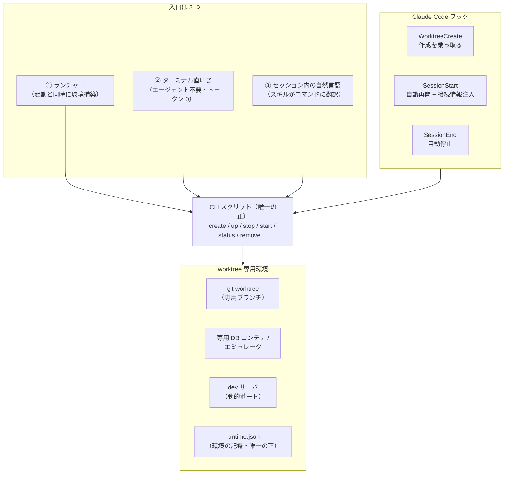

コーディングエージェントを使い始めると、作業の単位が「1 日 1 ブランチ」から「同時に 3〜4 タスク」に変わります。エージェントは待ち時間なく次のタスクに移れるので、人間側のボトルネックは「作業場所」になる。1 つのチェックアウトを取り合っていては、せっかくの並行性が死んでしまいます。

`git worktree` はこの問題の半分を解いてくれます。同じリポジトリから複数の作業ツリーを生やせるので、**コード**は隔離できる。しかし開発環境はコードだけでは動きません。DB、ポート、dev サーバ、コンテナ——これらは worktree を作っても共有のままです。worktree A で migration を当てたら worktree B のアプリが壊れる。両方で dev サーバを立てたらポートを取り合う。つまり `git worktree` だけでは「並行開発」にならないのです。

そこで、**worktree 1 つにつき専用の環境（DB・ポート・プロセス）を丸ごと生やし、そのライフサイクルを Claude Code のフックで自動管理する**仕組みを作りました。タスクを始めるとき 1 コマンドで環境ごと立ち上がり、セッションを閉じると環境も止まり、マージしたら跡形もなく消える。使い捨ての隔離環境です。

この仕組みを性質の異なる 3 つのプロジェクトで運用してきました。

- **プロジェクト A**: モノレポ。worktree ごとに専用 DB コンテナ + フロントエンド dev サーバ
- **プロジェクト B**: モノレポ。ローカルエミュレータ一式を使う構成（ポートが固定という制約つき）
- **プロジェクト C**: 複数リポジトリ（ポリレポ）。リポをまたいだ隔離環境が必要

制約はバラバラでしたが、最終的なアーキテクチャは同じ形に収束しました。本記事はその収束した設計——フック・スキル・CLI の役割分担と、運用して固まった設計判断——をまとめたものです。

# 全体像



登場人物は 3 種類だけです。

- **CLI スクリプト** … 作成・起動・停止・破棄の実処理をすべて持つシェルスクリプト（決定論・冪等）
- **フック** … Claude Code のライフサイクルイベント（worktree 作成、セッション開始・終了）を CLI につなぐ
- **スキル** … セッション内の自然言語の依頼を CLI のコマンドに翻訳する

以降、運用して固まった設計判断を 5 つに分けて説明します。

# 原則 1: 実処理は決定論 CLI に集約し、スキルは「翻訳係」に徹する

一番大事な判断はこれです。**環境の作成・採番・起動・破棄というオーケストレーションを、LLM に手順として実行させない。** すべて 1 本のシェルスクリプト（数百行）に実体化し、スキルの役割は「ユーザーの依頼をコマンドに翻訳して 1 回叩き、結果を報告するだけ」に絞りました。

スキル定義（SKILL.md）の中身は、実質この対応表だけです。

| ユーザーの言い方 | コマンド |
| --- | --- |
| 「TASK-1234 の環境を立てて」 | `up 1234` |
| 「バックエンドも含めてフルで動作確認したい」 | `up 1234 --with-backend --clone-db` |
| 「一旦止めて」（消さない） | `stop 1234` |
| 「さっきの再開して」 | `start 1234` |
| 「この worktree 破棄して」 | `remove 1234`（破壊的操作なので確認を挟む） |
| 「一覧出して」「状態は？」 | `list` / `status` |

エージェントに git や npm のコマンドを場当たりで打たせると、毎回微妙に違う手順になり、失敗時の状態も毎回違います。スクリプトに寄せると次が手に入ります。

- **冪等性と再現性** … 同じ入力なら同じ結果。途中失敗しても再実行できる
- **エージェント非依存** … ターミナルから直接叩けば LLM もトークンも不要。CI や別のエージェントからも使える
- **トークン節約** … スキル経由でも、モデルが考えるのは「どのコマンドか」だけ
- **テスト可能性** … `source` すると関数定義だけ読み込まれる作りにしておけば、採番ロジック等を単体で検証できる

スキルには「手作業で個別の git コマンドを打ち直さない（スクリプトが唯一の正）」と明記しています。LLM は賢いので、放っておくとスクリプトを迂回して「直したつもり」の手順を発明します。それを禁止する 1 行が効きます。

入口が 3 つあるのもこの設計の帰結です。実体が CLI なので、①起動ランチャーから、②ターミナルから、③セッション内の自然言語から、どこから呼んでも同じ動きになります。

# 原則 2: セッション = 環境の生存期間にする（SessionStart / SessionEnd）

環境のライフサイクルを人が管理すると、必ず立ち上げっぱなしの残骸が溜まります。そこで「**Claude Code のセッションが生きている間だけ環境も生きている**」に倒しました。

- **SessionStart フック** … cwd が管理下の worktree なら、停止中の環境を自動で `start` する
- **SessionEnd フック** … 同じく worktree なら自動で `stop` する（データは volume に保持され、次回の start で差分なく再開）

つまり `cd worktree && claude` するだけで環境が起き、`/exit` すると勝手に片付く。「止め忘れ」も「起こし忘れ」も構造的になくなります。

## SessionStart の stdout はコンテキストに注入される

SessionStart フックには重要な性質があります。**stdout（または `additionalContext`）がセッションのコンテキストに注入される**のです。これを使って、起動直後に接続情報を流し込みます。

```json
{
  "systemMessage": "[wt] 環境を再開しました",
  "hookSpecificOutput": {
    "hookEventName": "SessionStart",
    "additionalContext": "FE: http://localhost:60398 / DB: localhost:55231 (user/pass...)"
  }
}
```

これでセッション内の Claude も人間も、**最初から** URL と DB 接続情報を知っている状態で作業が始まります。「dev サーバどこで動いてる？」を毎回調べ直す必要がありません。動的ポート採番（後述）を採ると URL が毎回変わるので、この注入は特に効きます。

## 罠: `/clear` でも SessionEnd が発火する

運用して踏んだ罠を 1 つ。`/clear`（コンテキストのクリア）でも SessionEnd が発火し、直後に SessionStart が走ります。ここで素直に stop してしまうと、**作業中なのに環境が落ちて起動し直し**になります。フックの入力 JSON には `reason` が入ってくるので、これで分岐します。

```bash
REASON=$(echo "$INPUT" | jq -r '.reason // empty')
[ "$REASON" = "clear" ] && exit 0   # セッション継続中の clear では stop しない
```

# 原則 3: WorktreeCreate フックで「作成そのもの」を乗っ取る

Claude Code には `claude --worktree <name>` という起動方法があり、**WorktreeCreate フック**を定義すると worktree の作成自体をフックが担えます。契約はシンプルです。

- **stdout には worktree のディレクトリパスだけ**を出力する（それ以外のログはすべて stderr へ）
- exit 非ゼロで作成をブロックできる

このフックの中で `git worktree add` に加えて専用環境の構築（DB コンテナ・env・依存・dev サーバ）まで済ませてしまえば、`claude --worktree fix-login` の 1 コマンドで「環境ごと」立ち上がります。実運用で必要になった工夫が 3 つあります。

## 進捗を /dev/tty に複製する

フックの stderr は、Claude Code の仕様で debug モードでしか表示されません。環境構築は数分かかるので、無言のまま待たせると「固まった」ように見えます。端末が開けるときだけ `/dev/tty` に進捗を複製します。

```bash
# 判定は「実際に開けるか」で行う（-w が通っても開けない環境がある）
if (exec 4> /dev/tty) 2>/dev/null; then
  exec 3>&2 2> >(tee /dev/tty >&3)
fi
```

## 既存ブランチの残骸には「選択肢を提示して中断」

worktree を破棄してもブランチは履歴保全のため残します（後述）。すると同じ名前で再作成したとき、前回のブランチが既に存在するという状況が起きます。勝手に消すのも、勝手に再利用するのも危険です。しかし**フックは対話できません**。そこで、環境変数で方針を指定して再実行してもらう方式にしました。

- `reuse` … 既存ブランチを再利用（以前のコミットを引き継ぐ）
- `new` … suffix つきの新ブランチ（`-2`, `-3`…）を base から作成
- `delete` … 既存ブランチを削除して作り直し（base に無いコミットがあれば中断、`delete-force` で強制）
- 未指定 … 上記の選択肢を表示して中断する

「フックは対話できないので、判断が要る分岐は**中断 + 再実行方法の提示**に変換する」というパターンは、他のフックにも応用が利きます。

## ツーリング自身を worktree に自己複製する

worktree は base ブランチの内容でチェックアウトされます。base にまだフックやスキルがマージされていないと、その worktree で開いたセッションでは自動 start / stop もスキルも効きません。そこで WorktreeCreate フックの最後で、**フック・スキル・settings をメイン側から worktree にコピー**します。

このとき誤コミット防止が必要です。worktree ローカルの `.claude/.gitignore` にコピー分だけを列挙します。2 つ細かい注意があります。

- `git` の `info/exclude` は使わない … linked worktree でも**共有ファイル**なので、メイン側に影響してしまう
- **スキルは ignore しない** … gitignore されたファイルはスキル発見のスキャンから漏れることがあり、ignore するとスキル自体が使えなくなる

# 原則 4: フラグを渡せない入口には「環境変数プロトコル」

`claude --worktree <name>` には任意のフラグを渡せません。フックに届く stdin JSON にも argv は入っていません。しかし実際には「DB は実データを複製するか、スキーマだけか」「base ブランチはどれか」といったオプションが必要です。

答えは環境変数です。`WORKTREE_*` の名前空間でオプションを定義し、フラグを渡せない入口ではこれで指定します。

```bash
WORKTREE_TITLE="ログイン画面の改修" WORKTREE_DB=schema claude --worktree fix-login
```

CLI 直叩きのときはフラグで渡せるので、**「環境変数でもフラグでも指定できて、フラグが勝つ」**に統一しました。解釈ロジックは CLI 側の 1 関数に集約し、`__setup-opts` という確認用サブコマンドで「いまの環境変数がどう解釈されるか」を表示できるようにしています。フラグの届かない経路はデバッグもしづらいので、この確認口が地味に効きます。

独自ランチャーを作る場合も同じ方式が使えます。プロジェクト C では `claude` をシェル関数でシャドウするラッパーを用意し、独自フラグを横取りして環境変数に変換してから素の `claude` を起動します。SessionStart フックは**起動前にセットされた環境変数を継承する**（実測で確認済み）ので、フックがその変数を検出して環境構築にルーティングできます。

```text
claude -we 1234
  └ ラッパー: -we を横取り → WORKTREE_ENV_REF=1234 をセット → 素の claude を起動
      └ SessionStart フック: WORKTREE_ENV_REF を検出
           起動時 → CLI の create を実行
           resume 時 → status + DB 接続情報を提示
```

1 つ運用上の注意があります。SessionStart で自動実行するのは軽い処理（worktree 作成 + 記録）までにして、**重い処理（dev サーバ起動やコンテナの初回ビルド）はセッション入室後に回す**こと。フックはセッション開始をブロックするので、ここに 10 分級の処理を置くと起動体験が壊れます。

# 原則 5: 「衝突しない」は固定値を捨てて手に入れる

複数環境の同時稼働で一番厄介なのがポートとリソース名の衝突です。ここは 3 世代の進化がありました。

**第 1 世代: 固定ポート + 排他運用。** エミュレータ一式のポートが固定という制約のあるプロジェクト B では、同時 1 環境の排他運用にしました。SessionStart で `lsof` によりポート占有を検査し、他の環境が使っていれば起動せず、その旨をコンテキストに注入して人に判断を返します。制約下の次善策としては十分機能します。

**第 2 世代: 共有レジストリで連番採番。** 環境ごとに ID を採番し `port = base + ID * 100` とオフセットする方式です。これは 2 つの理由で破綻しました。レジストリ JSON の read-modify-write に**ロックがない**ため、2 セッション同時作成で同じ ID を取り全衝突する。そして固定ポートである以上、**無関係な既存プロセス**（メイン環境の dev サーバなど）との衝突は避けられない。

**第 3 世代: 内容由来 ID + 動的採番。** 現在の形です。

- **環境 ID** は `<タスクキー小文字>-<worktree パスの短縮ハッシュ>` のように**内容から決定**する。docker の compose project 名・コンテナ・volume・network の名前空間にこの ID を使う。ID が内容から決まるので、採番の競合が原理的に発生しない（共有レジストリも不要）
- **ポートは固定しない**。dev サーバは OS に空きポートを割り当てさせ（`socket.bind(("", 0))`）、コンテナは docker に割り当てさせて後から読み戻す。基盤系コンテナ（DB 等）はそもそも host に publish せず、docker network 内のサービス名解決で済ませる（GUI クライアント用の口だけ動的ポートで publish する）
- **subnet も固定しない**（docker の自動割当に任せる）

固定値を一切使わないので、何環境立てても衝突しません。代償は**予測可能性**です。URL が毎回変わるので、起動完了時に必ず表示し、原則 2 の SessionStart 注入で常にセッションへ流し込みます。

## runtime.json を「唯一の正」にする

動的に決まった実ポート・URL・PID・状態は、worktree ごとの `runtime.json` に記録します（gitignore 対象）。このファイルが環境の**唯一の正**です。

```json
{
  "env_id": "task-1234-cc92ae",
  "title": "ログイン画面の改修",
  "state": "running",
  "fe": { "port": 60398, "url": "http://localhost:60398", "pid": 12345 },
  "backend": {
    "compose_project": "task-1234-cc92ae",
    "db": { "port": 55231 }
  }
}
```

重要なのは、**破棄がこの記録を基に行われる**ことです。`remove` は runtime.json から PID・compose project・worktree パスを引いて、プロセス kill → `docker compose down -v` → 生成物削除 → `git worktree remove` まで確実に片付けます。「作ったものを記録し、記録から消す」を徹底すると、掃除漏れがなくなります。

# 不変条件 — スクリプトが保証し、壊す変更をしないもの

設計判断の上に、どのプロジェクトでも共通の不変条件を置いています。スキル定義にも「スクリプトが保証する。壊す変更はしない」と明記して、エージェントによる改変からも守ります。

1. **メイン環境に一切書き込まない** … 各リポの通常チェックアウト・ポート・コンテナ・DB・設定に触れない。バックエンドの compose 定義も書き換えず、外付けの override ファイルだけで差し替える（リポジトリ無改変）
2. **破棄ですべて消える。ただしブランチは保持** … `down -v` まで含めて専用リソースを全部片付ける一方、ブランチだけは残す。push 済みの PR に影響させないため
3. **平文シークレットを worktree に複製しない** … 認証情報入りの env ファイルはコピー対象から除外する
4. **破壊的操作には確認を挟む** … `remove` や DB の `restore` は、スキル側で対象と影響（未コミット変更が消える等）を提示してから実行する

# 日常運用と、地味に効くコマンド

日常のフローはこうなります。

```bash
create 1234 --desc "ログイン画面の改修"   # 環境を作る（worktree + 依存）
up 1234 --with-backend --clone-db        # 起動（DB はメインから複製）
stop 1234                                # 帰る前に一時停止（何も消えない）
start 1234                               # 翌日復帰（同じ DB のまま）
pr 1234                                  # push + PR 作成
remove 1234                              # マージ後に完全破棄
```

運用して追加することになった「地味だが効く」コマンド群も紹介しておきます。

- **`list`** … 全環境の一覧。作成時の `--title` / `--desc`（日本語可）を保持しておき、一覧に表示する。並行タスクが 4 つを超えると「これは何の作業だっけ」が本当に起きる
- **`doctor`** … 診断。必須ツールの有無、docker の状態、**記録（runtime.json）と実体の不整合**、孤児コンテナ候補を列挙する
- **`clean`** … 残骸検出。既定は報告のみで、確認してから `--force` で破棄。意図的に残す環境はマーカーファイルで保護できる
- **`snapshot` / `restore`** … DB の任意時点への巻き戻し。migration を試す作業で重宝する
- **`logs`** … dev サーバとコンテナのログを集約表示。`tail -f` はエージェントがブロックするので使わない

`doctor` と `clean` は「自動管理はいつか実体とズレる」ことを前提にした安全網です。フックの自動 stop が走らないままマシンが落ちることもあれば、docker だけ手で触ってしまうこともあります。**記録と実体の突き合わせを診断コマンドとして持っておく**と、ズレたときに手作業のフォレンジックをしなくて済みます。

# まとめ

- `git worktree` はコードの隔離まで。**環境（DB・ポート・プロセス）の隔離と生存管理**はフックと CLI で作る
- 実処理は決定論 CLI に集約し、スキルは翻訳係に徹する。入口（ランチャー / ターミナル / 自然言語）が増えても実体は 1 つ
- SessionStart / SessionEnd で「セッション = 環境の生存期間」にする。SessionStart の stdout 注入で接続情報を最初から共有する
- フックは対話できない・argv も届かない。判断は「中断 + 再実行方法の提示」に、オプションは「環境変数プロトコル」に変換する
- 衝突回避は固定値を捨てるのが本筋。内容由来 ID + 動的採番 + runtime.json（唯一の正）で、同時稼働数の上限をなくす

エージェントとの並行開発は「エージェントが速いか」より「作業場所を何個並べられるか」で律速します。worktree 単位の使い捨て環境は、その並べる側の基盤です。なお、並行セッションが増えたときの「どのリポをどこまで触ってよいか」というスコープと権限の側は、別記事[「注意力ではなく設定で固める — コーディングエージェントのスコープと権限ガードレール」](https://zenn.dev/cilly/articles/agent-scope-permission-guardrails)にまとめています。あわせてどうぞ。
